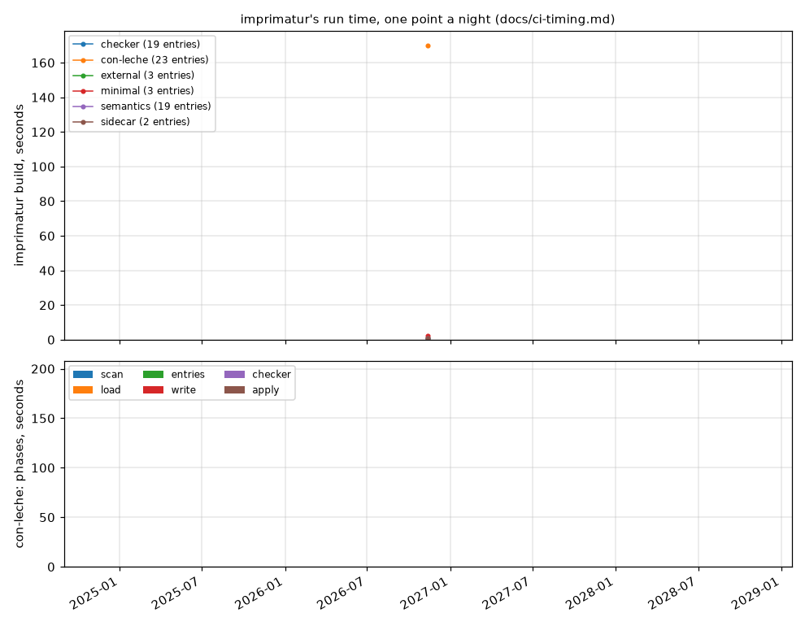

# imprimatur's run time

One point a night: the seconds `imprimatur build` takes on each paper the
nightly builds, imprimatur's own phases only (Lake's build of the
development and `latexmk` are outside the interval). Above, the total per
paper; below, the largest paper's phases stacked, since a regression lands
in one of them: `load` is the elaboration of the notation module, `entries`
the dependency cones and axioms, `export (other)` the splicer's wait beyond
the extractor's own phases. The verified checker runs alongside the
extractor, so it is a dashed line rather than a layer: where the line is
above the extractor's phases, the wait is for it (con-leche's first night:
170 s of checker over 28 s of extractor).

The points are in [`log.jsonl` on the `timing`
branch](https://github.com/theorem-press/imprimatur/blob/timing/log.jsonl),
one JSON line per paper per run, written by `scripts/timing-fold.py` from
the timing files `scripts/e2e.sh` keeps. Every CI run shows its own numbers
against the nightly medians in its job summary, and the nightly fails when
a paper takes more than twice its median of the last ten nights. The design
is [docs/ci-timing.md](ci-timing.md).

The papers: the four examples under `examples/` (1 to 19 entries),
`papers/con-leche` (23 entries, the verified checker on its own
development), and, in its own repository, the paper about imprimatur
(104 entries).
